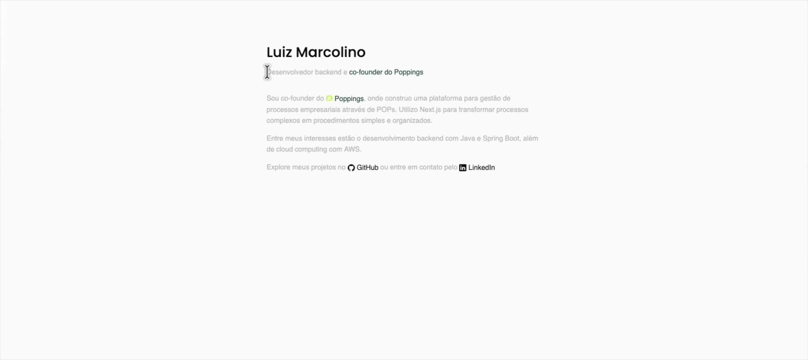

  

 Desenvolvedor · Backend Java & Spring Boot

O projeto ainda é simples e tem poucas informações, mas pretendo atualizá-lo aos poucos, adicionando minhas certificações, cursos e projetos que estou desenvolvendo.

> Mas algumas coisas estão presentes desde o início: o cuidado com os padrões de commit, boas práticas de UI/UX e, principalmente, um design system criado inteiramente por mim no Figma, desde o começo do projeto.

<kbd>HTML5</kbd> <kbd>CSS3</kbd> <kbd>FIGMA</kbd> <kbd>VSCODE</kbd> <kbd>GIT</kbd> <kbd>GITHUB</kbd>

Esse projeto foi realizado com muito carinho.